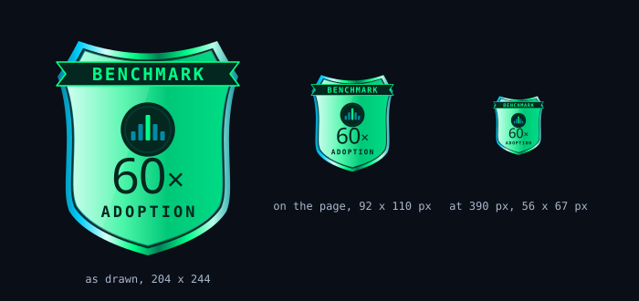

# Build request: Gem Screener, the Chains tab after ET-28688 (cymetica.com/gem-screener/app)

**For:** the lead agent of the Cymetica SDLC pipeline
**From:** Adam (product owner, Gem Screener)
**Scope:** the Chains tab: which chains it lists, what a chain's adoption is, the benchmark and its badge, and the chart column and card; and on both tabs the size of the badges, the small print on Top Picks and what the Revenue column on Apps says. Build or change only what is named; leave the rest of the app as it is.

> **HOW TO READ THIS SPEC**
> 1. **Goals, not methods.** How you build it is your call. Where an item gives a rule or a number, it is a good default, and you may improve it; say what you changed and why in your spec.
> 2. **Every number is read on 2026-10-01** from the live page's own snapshot (generated 13:42 UTC), from DefiLlama and from CoinGecko. They are there so you can check that a change took effect; they are not the requirement.
> 3. **English only**, degen-friendly: the number first, plain short words.
> 4. **Keep the look.** Change only what an item names.
> 5. **This spec starts from ET-28688 as built.** Two things are not here because they are already in hand: the orange for every warning (item 7 of ET-28688) and the altseason universe without assets priced at a currency unit (item 35 of ET-28606, which you said you are fixing under ET-28688).
> 6. **The files are in this folder.** `assets/` holds what is ready to use; `reference/` holds a mock of what is wanted (inspiration, not literal).

## What is ready to use (`assets/`)

| File | For item | What it is |
|---|---|---|
| `assets/benchmark-badge-adoption.svg` | 4 | The Chains benchmark badge: the badge of item 13 of ET-28688 with a neutral emblem in the medallion, "60×" and ADOPTION. |

---

## 1. Which chains the tab lists

**[1] The tab lists the L1 and L2 chains people look for, not only the chains DefiLlama shows fees for.** Live: 26 chains, taken from the chains that earn fees above a floor ($10K over 30 days, `collection_floor_usd_30d` in the snapshot). Of the 40 largest Layer 1 coins on CoinGecko, 17 have a DefiLlama chain row and are not on the tab: BTC, XRP, ZEC, ADA, BCH, LTC, CC, HBAR, TAO, CRO, ETC, ALGO, STABLE, VET, XDC, FLR, SEI. IOTA (rank 49 of Layer 1, market cap $258M; on DefiLlama its TVL is $2.0M) is not on the tab either.

The owner wants the list to be **every chain whose native token is in CoinGecko's "Layer 1" or "Layer 2" category with a market cap of $200M or more** (a good default; today that is 59 tokens, 47 of them with a DefiLlama chain row), each joined by its CoinGecko id (`gecko_id`) to DefiLlama's chain list, the data behind https://defillama.com/chains, for TVL, daily active addresses, DEX volume and stablecoins. DefiLlama alone does not give the list: its chain list has 468 chains, 316 of them with a CoinGecko id, and no field that says L1 or L2, while CoinGecko's two categories do. **A chain with no DefiLlama row, or with any of the four inputs missing, so that its adoption cannot be calculated, is not shown at all**: no row, no "no data" line (7 of the 40 largest Layer 1 coins have no DefiLlama row today: XMR, M, KAS, PI, NIGHT, BDX, TIA). Whether the 17 chains above and IOTA have all four inputs is for the build to find out; your spec lists the tokens of the list that were left out and the input each one lacks. Fees above a floor are no longer a condition for being listed. Chains without a token of their own (Base, Robinhood Chain, Ink, Abstract) stay off, as today. The list is rebuilt at every refresh.

---

## 2. What a chain's adoption is

**[2] A chain's adoption is real adoption: not fees, and hard to fake.** Live: adoption is the geometric mean of the chain's yearly fees and its daily users valued at a reference fee, sqrt(fees × users × 1.2016 × 365); recomputed on six chains it equals the page's `adoption.value` to six digits (where the page's own guards discount a chain's fees, as on Tron, the page's value is lower). So fees carry half the weight: at the same users, a chain with fees 10× cheaper gets about 3.2× less adoption, and Ethereum, with about 4× Sui's users (520K against 131K a day), gets about 15× its adoption. A fee in dollars is also gas times the token's price, so it rises with the price it is compared with. The owner said it before (item 13 of ET-28606): "yearly activity fees say what users paid, not how many use the chain". TVL, DEX volume and active users must all count, and no single input may lift a chain cheaply. A good default, which you may improve (say what and why):

- **Four inputs per chain, from DefiLlama.** U = daily active addresses, the lower of the 30-day and the 90-day median (a campaign spike counts only once it lasts). V = DEX volume over 30 days. T = TVL without the chain's own token and without double counting (TVL in its own token rises with the price it is meant to judge; the page does not split it today). S = stablecoins on the chain.
- **Cheap signals count only as far as expensive ones back them.** Addresses and volume are cheap to fake (bots, airdrop farming, wash trading), cheapest on cheap chains; TVL and stablecoins cost real money. U counts at most up to the 80th percentile, across the listed chains, of users per dollar of T or of users per dollar of S, whichever backs more (a payments chain such as Tron or Stellar holds its money in stablecoins, not in DeFi). V counts at most up to the 80th percentile of 30-day turnover, V / T.
- **Adoption = (U × V × T × S)^(1/4)**, with the held-back U and V: a geometric mean, so no input carries a chain on its own.
- **No fees in it.** Fees may stay as a column of their own.
- **No users squared** (Metcalfe's law): it squares fake addresses too, and across today's chains market cap grows with users at a power of about 0.4, not 2.
- **A missing input** means the chain is not shown (item 1): adoption is never made from three inputs, and there is no "no data" row.

**[3] The benchmark is the median of the large chains, and Upside follows it.** Today the benchmark is one chain, the one with the most adoption (Solana, 38×), and every chain's Upside is that chain's multiple divided by its own. With the new adoption the same rule would pick Ethereum (90×); the owner does not want that: Ethereum's price carries its role as money, so as the yardstick it makes 14 of the 22 chains with all four inputs look cheaper, Polygon by 20×, and one chain re-pricing would move every Upside on the tab. The owner wants:

- **Multiple** = market cap ÷ adoption. **Upside** = the benchmark multiple ÷ the chain's multiple (the same form as today). The price-tag line follows the same numbers.
- **Benchmark = the median multiple of the eligible large chains**: a year of data or more, market cap $1B or more, all four inputs fresh, and the held-back part at most half of the chain's users or volume. On the page's 22 chains that have all four inputs today, 14 chains are eligible (Avalanche, Polygon, Ethereum, Stellar, Solana, Sui, TON, Tron, ICP, Hyperliquid L1, Mantle, Arbitrum, BSC, X Layer) and the median is **60×**. Both the number and the list will move when item 1 widens the tab: say in your spec what the new benchmark is and which chains make it.

**[4] The Chains badge shows the median, with a neutral emblem.** Today the Chains badge is the shield of item 13 of ET-28688: ribbon BENCHMARK, Solana's logo in the medallion, "38×", "adoption". The benchmark is no longer one chain, so no chain's logo belongs in it.

The badge as a vector, ready to start from: `assets/benchmark-badge-adoption.svg`. It is the same shield, rim, ribbon and type as the badge of ET-28688, in the page's own colours (none is new). The mock is inspiration, not literal: the shape, the proportions and the wording are yours to improve, as long as it reads at a glance as the same badge with BENCHMARK on it.

- **Only the Chains badge changes.** The Apps badge (Hyperliquid, revenue) stays as built.
- **Shape and place** as in ET-28688: at the right end of the toolbar under the Legend button; the size is that of item 8. The number is the benchmark multiple (**60×** today) and the word under it is **ADOPTION**; both come from the snapshot at each refresh, not typed.
- **The medallion holds a neutral emblem**: five bars with the middle one lit, the median, "the typical one", in the page's cyan and green. At 56 px (390 px) the emblem stays and the ribbon word may drop to the tooltip, as ET-28688 already allows.
- **The tooltip** (hover, focus and tap, the dark card), in plain words: "The benchmark. A typical large chain is worth 60 times its adoption: the median of 14 chains with a market cap of $1B or more and a year of data (Avalanche, Polygon, Ethereum, Stellar, Solana, Sui, TON, Tron, ICP, Hyperliquid L1, Mantle, Arbitrum, BSC, X Layer). Adoption counts daily users, DEX volume, TVL and stablecoins together, so no single number can lift it. Every Upside on this page is measured against it." The names are the chains that qualify at that refresh.
- **The accessible name** is "Benchmark: the median of 14 large chains, 60x adoption", then the tooltip text, as the live badge does with its `aria-label`.

**[5] A tag where the token does not collect the chain's fees.** On some chains gas is paid in another token, so the chain's own token earns none of it. DefiLlama says which: its `gasTokenGeckoId` differs from the chain's `gecko_id`. Today that is Arbitrum, OP Mainnet, Linea and ZKsync Era (gas in ETH), and two of them have among the largest Upsides below. The owner wants a tag on the row and in the detail, in the page's tag style, in plain words: "Gas is paid in ETH: this token does not collect the chain's fees." A tag, not a gate: the chain stays listed and keeps its Upside.

**[6] Wherever adoption shows, it is this measure, and the numbers can be read.** The Adoption column, the chain detail's Adoption tile, the price-tag line and the Upside all use item 2's adoption. Its tooltip names the four inputs in plain words and says whether any was held back to what the chain's money backs. "How it's calculated" and the chain's record in the API carry the four inputs, the held-back values and the adoption, and the API fields are documented where the page's other chain fields are.

### What it gives today (to check the direction, not a target)

On the page's own data, the 22 chains that have all four inputs, with TVL as the page holds it today (the chain's own token still in it); with the token taken out the figures move.

- **Adoption order:** Ethereum, Solana, BSC, Tron, Polygon, Arbitrum, Avalanche, Hyperliquid L1, Sui, Monad, X Layer, Plasma, OP Mainnet, Stellar, Near, TON, Aptos, Mantle, Starknet, Linea, ICP, Filecoin.
- **Upside against 60×:** Polygon 13.6, Monad 13.2, Arbitrum 10.9, OP Mainnet 8.8, Plasma 7.3, Tron 2.5, Aptos 2.5, Linea 2.1, Avalanche 2.0, Starknet 1.9, Solana 1.5, X Layer 1.4, Sui 1.1; below 1: BSC 0.9, Ethereum 0.7, Hyperliquid L1 0.5, TON 0.4, Near 0.3, Stellar 0.3, Mantle 0.3, ICP and Filecoin about 0. Thirteen of 22 are above 1; the page has 5 today, with Polygon at 5.6.
- **What the held-back part changes:** volume on Near (−76 %), Solana (−48 %), Polygon (−32 %) and Hyperliquid L1 (−27 %), users on Filecoin (−6 %) and TON (−4 %); nothing else moves.
- **Faking 10× the users and 10× the DEX volume** lifts adoption ×1.2 on Near and Solana, ×1.5 on TON, ×1.6 on Sui, ×2.2 on Monad and ×2.85 on Tron (its stablecoins back many users). Without the held-back part it is ×3.2 everywhere; with today's measure ×3.2, or ×10 if the fake transactions also pay fees.

---

## 3. The chart on Chains

**[7] Chains get the Chart column and the Chart card, as Apps have them.** Live: the Apps table has a Chart column, a score from 1 to 100 (61 on Pharaoh) from the Chart Analyzer, and the Apps detail has the Chart card (the score and its band, below 40, 40 to 60 and 60 and up; the 90-day chart; the scale; "Open in Chart Analyzer ↗" and its notes). The Chains table has no such column and a chain's detail has no such card: none of the 26 chains carries a chart score in the snapshot. The owner wants both on Chains, **the same component as on Apps, not a second look**:

- **The column** in the Chains table in the same place as on Apps (after the 12-month chart, before Upside), with the same cell, header, tooltip and sorting.
- **The card** in a chain's detail, the same card as in the Apps detail, in the place it has there: directly under the header.
- **The data is the same service**, https://cymetica.com/api/v1/chart-analyzer, on the chain's native token. The Chart Analyzer already holds exchange candles (Binance spot) for 292 symbols, and of 42 chain tokens tried (those of the chains on the tab today and the larger Layer 1 coins of item 1) 33 are among them (SOL, ETH, BNB, SUI, TRX, AVAX, ADA, TAO, HBAR, SEI and IOTA, for example), so a chain's token can be scored by its symbol. The 9 it does not hold (today CRO, FLR, HYPE, MNT, MON, OKB, QUAI, TON and XDC) are scored from the token's DEX pool by contract address as Apps are, or left without a score. How you reach each token is yours.
- **The card carries what the Apps card carries** (its notes and the source of the candles); nothing is added to it or left out of it for chains.
- **A chain whose token cannot be scored** shows in the column what an app without a score shows, and its detail leaves the card out instead of showing an empty one (item 16 of ET-28688: nothing shown empty).

---

## 4. Smaller badges, less small print

**[8] The badges are smaller: the toolbar is as tall as its controls need.** Live, at 1360 px: the badge is 92 × 110 px and the toolbar is 122 px tall around controls that are 31 and 32 px high; the header (130) and the toolbar together pin 252 px of a 900 px screen, and set in a row of small controls the badge looks too big. The owner, looking at both tabs: the badge is too tall for the row and does not look good on Apps or on Chains; a bit smaller would be better. A good default: the badge about 78 px tall (today 110), the toolbar no taller than about 96 px (today 122), the pinned area about 226 px (today 252).

Do not only scale the drawing down: the word BENCHMARK is 8.6 px high today and has to stay readable, at least 8 px; scaled to 78 px tall it would be 6 px (the third badge in the mock under item 4). Draw it flatter instead: a lower shield, the ribbon, the number and the word under it kept at today's size, the medallion and the lower point giving up the height. Both badges, Apps and Chains, get the same size. At 390 px the rule of ET-28688 stays (about 56 px wide, the ribbon word may drop to the tooltip).

**[9] Top Picks: the small grey sentences nobody reads are gone.** The owner, looking at the Hot sectors cards: these small texts are unnecessary, nobody will ever read them. Live, each Hot sectors card has, under its name, a stage pill and trend icons, two grey lines at 10.5 px: "+38% vs the median sector this month, too few people talking to measure" (or "…talked about by 1.1% of people") and "Leaders: Collector Crypt 26x · Securitize 19x · Ready Cards 4.5x". The owner wants:

- **The two lines are gone from the card.** The card keeps the sector name, the stage pill, the trend icons and the fund line ("Gem Screener RWA · +5.4% since launch · Fund →").
- **Nothing is lost:** what the two lines said (the move against the median sector, how much the sector is talked about, the leaders with their multiples) moves into the card's tooltip, the one dark card of item 17 of ET-28688, on hover, focus and tap, in plain words, the numbers first.
- **The same for the paragraph under the backtest verdict** ("The criteria were written down and locked before the first result. So treat the cards below as an overview…", 10.5 px grey): it goes behind the verdict's own expand or tooltip; the verdict line itself ("Backtest 2024–2026: INCONCLUSIVE") stays.
- **What stays:** the reason lines on the pick cards ("Watch out: …", "DEX & perps theme already leads", the "$5.4M → $181.5M if valued like Hyperliquid" line), because they say why a coin is on the list.

---

## 5. Apps: what the Revenue column says

**[10] The Revenue column is revenue, and nothing else.** Live, the Revenue 30d column on Apps shows the revenue and under it a second line: "net +$1.2M" in green, "net −$1.3M" in red, or "net unknown" in grey; its tooltip says "Revenue $2.5M minus $1.3M paid in tokens, last 30 days." In the Vetted view 50 of the 76 rows show a green net, 5 a red one and 21 "net unknown" (the emissions list from DefiLlama covers 117 of the 215 apps). The owner: that does not fit in the revenue column. Revenue is the protocol's income in USDC; minting new tokens is free for the protocol and has nothing to do with it, so a red "net −$1.3M" under a positive revenue reads as a loss the business never made.

The owner wants the column to show the revenue and nothing under it: the "net" line and "net unknown" are gone, and the tooltip says what the number is (the income of the last 30 days, in USD). Tokens paid out are still worth knowing, because they dilute holders, but as a thing of their own: the Earnings check and line in a coin's detail, which set revenue against new tokens, stay as they are. An Emissions column of its own is a later question and not part of this item.

---

## Checklist (one line each; done when all are true)

- [ ] 1 The Chains tab lists every chain whose token is in CoinGecko's Layer 1 or Layer 2 category with a market cap of $200M or more (or the cut you chose, named in your spec), joined to DefiLlama by `gecko_id`.
- [ ] 1 A chain is on the tab only if all four inputs exist for it; a chain with a missing input, or no DefiLlama row, is not shown at all (no row, no "no data" line).
- [ ] 1 The spec names the chains of the token list that were left out for a missing input, with the input each lacks, and says whether BTC, XRP, ADA, HBAR, TAO, CRO, ALGO, SEI and IOTA are on the tab.
- [ ] 1 Fees above a floor are not a condition for being listed; chains with no token of their own (Base, Robinhood Chain, Ink, Abstract) are still off.
- [ ] 2 A chain's adoption is made of daily users, DEX volume, TVL without the chain's own token, and stablecoins; fees are not an input.
- [ ] 2 Users and volume are held back to what the chain's TVL or stablecoins back; the spec says the rule chosen and the cut used.
- [ ] 2 Multiplying a chain's users and DEX volume by 10 lifts its adoption by less than 3×, and the spec shows the test for at least five chains.
- [ ] 2 A chain missing an input is not shown; no adoption or Upside is ever made from three inputs.
- [ ] 3 The benchmark is the median multiple of the eligible large chains (a year of data, $1B or more, all four inputs, no more than half held back), not one chain; the spec says its number and its chains after item 1.
- [ ] 3 Upside = the benchmark multiple ÷ the chain's multiple; the price-tag line follows.
- [ ] 4 The Chains badge has the neutral five-bar emblem in the medallion, the live benchmark number and ADOPTION; the Apps badge is unchanged.
- [ ] 4 The badge's tooltip names the chains the median is made of; it fits at 390 px and at 1360 px at the size of item 8.
- [ ] 5 Arbitrum, OP Mainnet, Linea and ZKsync Era carry the tag "Gas is paid in ETH: this token does not collect the chain's fees" (when they are listed); the tag does not hide the row or change its Upside.
- [ ] 6 The Adoption column, the detail tile, the price-tag line and the Upside all use the new adoption; the tooltip names the four inputs; the API record carries the inputs, the held-back values and the adoption, and the fields are documented.
- [ ] 7 The Chains table has a Chart column in the same place, with the same cell, header, tooltip and sorting as on Apps, scored by the Chart Analyzer on the chain's native token.
- [ ] 7 A chain's detail has the Chart card, the same component and place as on Apps (band, scale, "Open in Chart Analyzer ↗", its notes).
- [ ] 7 A chain whose token cannot be scored shows in the column what an app without a score shows, and its detail has no empty card.
- [ ] 7 The spec says, for each listed chain, whether its token is scored from exchange candles, from a DEX pool, or not at all.
- [ ] 8 At 1360 px the Apps and the Chains badge are about 78 px tall (today 110), the toolbar no taller than about 96 px (today 122), and the pinned header and toolbar about 226 px (today 252).
- [ ] 8 The word BENCHMARK on the badge is at least 8 px high; the badge still reads as a badge with the number and its word, and both badges are the same size on both tabs.
- [ ] 8 At 390 px the badge keeps the rule of ET-28688 (about 56 px wide, the ribbon word may drop to the tooltip) and covers no control.
- [ ] 9 A Hot sectors card on Top Picks shows the sector name, the stage pill, the trend icons and the fund line; the "vs the median sector" line and the "Leaders" line are gone from it.
- [ ] 9 What those two lines said is in the card's tooltip (hover, focus, tap), in plain words with the numbers first.
- [ ] 9 The paragraph under the backtest verdict is behind the verdict's expand or tooltip; the verdict line stays; the reason lines on the pick cards stay.
- [ ] 10 The Revenue 30d column on Apps shows the revenue only: no "net" line, no "net unknown", no green or red figure under it.
- [ ] 10 The revenue tooltip says what the number is (income over the last 30 days, in USD) and no longer subtracts tokens paid out.
- [ ] 10 The Earnings check and line in a coin's detail, which set revenue against new tokens, are unchanged.
