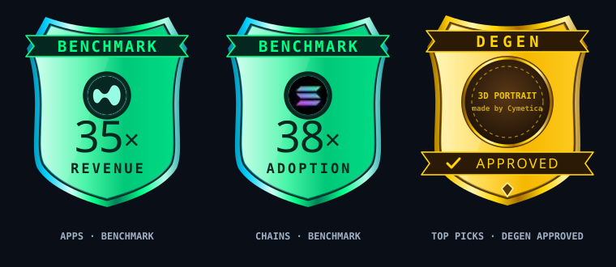

# Build request: Gem Screener, changes after ET-28688 (cymetica.com/gem-screener/app)

**For:** the lead agent of the Cymetica SDLC pipeline
**From:** Adam (product owner, Gem Screener)
**Scope:** the open changes to the Gem Screener app after ET-28688. Build or change only what is named; leave the rest of the app as it is.

> **HOW TO READ THIS SPEC**
> 1. **Goals, not methods.** How you build it is your call. Where an item gives a rule or a number, it is a good default, and you may improve it; say what you changed and why in your spec.
> 2. **Every number is read from the live site on 2026-10-01.** They are there so you can check that a change took effect; they are not the requirement.
> 3. **English only**, degen-friendly: the number first, plain short words.
> 4. **Keep the look.** Change only what an item names.
> 5. **The files are in this folder.** `assets/` holds what is ready to use; `reference/` holds mocks of what is wanted (inspiration, not literal).

## What is ready to use (`assets/`)

| File | For item | What it is |
|---|---|---|
| `assets/degen-approved-badge-frame.svg` | 1 | The gold badge with its ribbons and an empty round medallion for the portrait. |

---

## 1. Top Picks

**[1] A third top badge: DEGEN APPROVED, with a 3D caveman.** ET-28688 gave the Apps and Chains tabs a badge each (the green metal shields that say BENCHMARK). Top Picks gets the third one of the family: a **gold** shield that says **DEGEN** on the ribbon at the top and **✓ APPROVED** on the banner below, with a round medallion in the middle. It stands for the Degen picks: the apps that pass all seven degen gates (live: "10 of 215 apps pass all 7 gates").

**The portrait in the medallion is a 3D rendering, not a drawing:** a Neanderthal man, head and shoulders, filling the circle. The owner wants the look and the mood of the well-known "Neanderthal at the screen" picture: lit warmly from below, as if by a screen, against a dark brown ground, and this face:

- long, shaggy, dark-brown hair falling over the ears and the sides of the face, a low fringe;
- a heavy brow ridge with thick eyebrows, the inner ends a little raised;
- deep-set blue-grey eyes looking **up and slightly past the viewer**, at a screen, with an eager, fixed stare;
- a broad, rounded nose and full cheeks with smile creases;
- a short, scruffy beard and stubble;
- a **sly, eager, slightly sheepish grin** that shows the upper teeth, with a **small gap between the two front teeth**.

The portrait is **your own original image**: made or generated by you, of nobody real. Do not use the film still the meme comes from or any other photograph of a real person; the owner can show it to you as a mood picture, but it may not appear on the page. It has to read at the badge's real size (about 100 px across the medallion): the face large, the expression strong, no fine detail that disappears when small.

**The frame is ready** (`assets/degen-approved-badge-frame.svg`): the gold metal rim, the DEGEN ribbon, the APPROVED banner with its check, the small gem at the point, and the round medallion (centre 100,110, radius 54 in the SVG's coordinates) left empty for the portrait, clipped to the circle. It is the same shield as the two benchmark badges, in gold.

**Where it sits.** At the right end of the Top Picks headline row ("10 of 215 apps pass all 7 gates"), under the Legend button, the same place the benchmark badges take on Apps and Chains. About 100 x 115 px; at 390 px it shrinks (about 60 px wide) and does not cover the headline.

**Its tooltip** (the page's dark tooltip card, on hover, focus and tap): "Degen approved. The apps that pass all seven degen gates: 10 of 215 today. A research screen, not a signal." with the gates named as the Legend names them.

---

## Checklist (one line each; done when all are true)

- [ ] 1 Top Picks shows a gold DEGEN APPROVED badge (the ribbon DEGEN, the banner ✓ APPROVED, a round medallion), the same shield family as the two benchmark badges, at the right end of the headline row under Legend.
- [ ] 1 The medallion holds an original 3D-rendered Neanderthal portrait in the expression described (hair over the ears, heavy brow, eyes looking up past the viewer, a sly grin with a gap between the front teeth, warm light from below); no photograph of a real person is used.
- [ ] 1 The portrait reads at the badge's real size; the badge fits at 390 px without covering the headline.
- [ ] 1 The badge opens the dark tooltip card on hover, focus and tap, saying what "degen approved" means and how many apps pass today.
