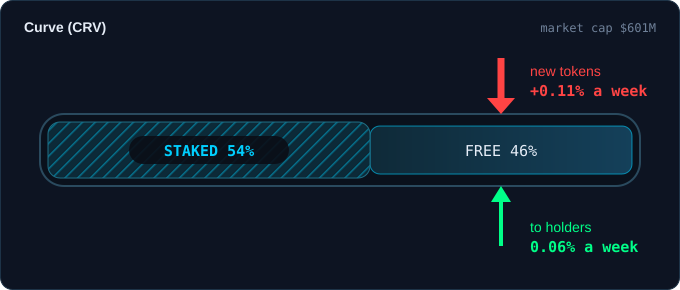

# Build request: Gem Screener, the pipe: what a token's holders are up against (cymetica.com/gem-screener/app)

> **DRAFT, PARTLY SUPERSEDED (2026-10-02).** Items 1 to 3 (the pipe, staked tokens, what goes back to holders) are now the Supply Analyzer, `outbox/supply-analyzer/SPEC.md`. Items 4 to 6 (what a "0%" says, insiders moving tokens, ETH/BTC) are not in it and are still open. Do not upload this file as it stands.

**For:** the lead agent of the Cymetica SDLC pipeline
**From:** Adam (product owner, Gem Screener)
**Scope:** how many of a token's coins can be sold, what flows in as new tokens, and what flows back to holders, on a coin's detail; the reading of "0% to holders"; an alert when insiders move tokens; ETH/BTC on the Altseason panel. Build or change only what is named; leave the rest of the app as it is.

> **HOW TO READ THIS SPEC**
> 1. **Goals, not methods, and no sources.** Where the data comes from, and how you build it, is your call. Where an item gives a rule or a number, it is a good default, and you may improve it; say what you changed and why in your spec.
> 2. **Every number is read on 2026-10-01 or 2026-10-02** from the live page and its snapshot of 23:35 UTC on 1 October. They move with every refresh; they are there so you can check that a change took effect, not as the requirement.
> 3. **English only**, degen-friendly: the number first, plain short words.
> 4. **Keep the look.** Change only what an item names.
> 5. **This spec starts from ET-28821 as shipped.** Dilution stays what it is there: gross, the larger of the emissions of 30 days and the unlocks of the next 30 days, one figure for the page. Nothing in this spec subtracts one figure from another.
> 6. **Unknown is never zero.** Where a figure has no public labelled source, the page says "unknown" in grey. This holds for every item below.
> 7. **The picture is in this folder:** `reference/pipe-mock.svg`. It is inspiration, not literal, and uses the page's own colours.
> 8. **If you need a list from us** (addresses of contracts or wallets, with a public source each, for the apps you want first), say which apps and we will supply it.

---

## 1. The pipe on a coin's detail

**[1] The "Market cap & supply" card shows the pipe: how much of the token can be sold, what flows in, what flows back.** Live, the card has the bar, market cap and FDV, "+0.3% new tokens a week" with its flag, and the next unlock. It does not say how much of the tokens out are locked away, and it does not show what the project pays back to its holders in the same unit as the dilution.

The picture is Curve, as the page's own data and a public listing of its staking read on 2026-10-01: market cap $601M, about 54% of the tokens out staked, new tokens 0.11% a week, 0.06% a week to holders. The owner wants:

- **A pipe**: its length is the tokens out, the hatched part is what is staked or locked and cannot be sold, the open part is free to trade.
- **Two arrows into the open part**: red for new tokens a week (the Dilution figure of ET-28821, unchanged), green for what goes to holders a week (item 3). Both are % of market cap a week, so they compare at a glance. **The thickness of an arrow follows its number** (a good default: about 60 px per 1% a week, capped).
- **No net figure.** The pipe never shows "green minus red"; the two stand side by side, as the owner keeps revenue and dilution apart.
- **What is not known is drawn as not known**: a grey dashed pipe or arrow, with the word "unknown" or "not tracked", never a zero and never an empty arrow.
- **The numbers are in the picture and nothing else is**: no sentences on the card. What a reader needs to know of how a figure is made goes in the card's tooltip, in plain words, about 25 words.
- **Where it stands:** in the card, below the bar; no new section, no new card, and nothing is added to the table rows or to the pick cards.

## 2. Staked or locked tokens

**[2] The share of the tokens out that is staked or locked in the project's own contracts is shown, where it is known.** Live, no figure on the page says it, and a reader who sees "61% of tokens out" cannot tell whether half of those cannot be sold. The goal is the figure itself, "54% staked", in the pipe of item 1 and in the Supply row of the checks; and, where it is known, the to-holders figure of item 3 against the free part only, in the tooltip ("0.14% a week of the free part"). A value above 100% of the tokens out means the sources count supply differently: show "unknown", not a number. **How firmly the tokens are locked matters as much as how many.** Staked tokens that anyone can take out at once are barely out of the pipe; tokens locked for 3 months, or until a date, are. Where the terms are known, the card says it in a few words ("locked until 12 Dec", "unstake takes 7 days", "can leave at once"); where they are not, it says "terms unknown", and the hatch is drawn lighter for tokens that can leave at once.

## 3. What goes back to holders

**[3] What goes back to holders is shown in the same unit as Dilution, and by kind.** Live, the Apps table has "To holders" as a share of revenue, and the detail has a "Holders share" check. Neither says how large the money is next to the token, nor whether it buys the token in the market (a buyback, a burn) or is paid out (to stakers or lockers). The owner wants **one figure: to holders, % of market cap a week**, from the same 30 days as the revenue, labelled by kind where the kind is known: "buyback & burn", "payouts", or both. Where burns are known, the tokens burned in the last 30 days stand in the tooltip.

- **How firm the buyback is is told in a few words**: a programmatic one with an end date or no way back ("50% of revenue, until Nov 2026"), against one at the team's discretion. The same money is a different promise.
- **A buyback with no published buying wallet is "unknown", not zero.** The same for any figure the project does not publish.
- **It is not netted.** Dilution stays gross (ET-28821 items 10 and 25), and nothing is subtracted from it.
- **It is not a sort key, and not a gate.** Two readings of "0% to holders" meet here: the page reads it as a warning ("the token may never earn the upside"), and a project that has not switched its fees on yet can be the best case. The page shows the facts and leaves the reading to the reader.

Live examples, from the page's own data: Pump 0.21% a week to holders (buyback & burn) against 0.35% a week of new tokens; PancakeSwap 0.14% against 0.04%; GMX 0.10% against 0.00%; Hyperliquid 0.07% against 0.00%.

## 4. A "0%" says what it is

**[4] The check and the report line "Holders share · Bad · 0.0% of revenue to holders" say what the zero is.** Live, it reads the same for three different things: a measured zero, a project that has its fee switch off, and a figure that is not measured. Collector Crypt, a Degen pick ($12.4M revenue a month), shows "0.0%" and "Almost no revenue reaches holders", while the project says buybacks are neither confirmed nor denied and disclosed only after they are done, and publishes one burn of 22.5 million tokens (29 August 2026). Meteora, also a pick, shows 0% while a public description says part of its trading fees goes to discretionary buybacks. The owner wants:

- **A measured zero reads "0%" with what is known beside it** ("fee switch off, revenue goes to the treasury").
- **A figure the sources do not measure reads grey, "not tracked", and is not "Bad".**
- **Where the sources disagree** (a project that says it buys back, and a figure of 0), the line is grey and says so.

## 5. Insiders moving tokens

**[5] Where a project has published its team, treasury or investor wallets, tokens sent from them to an exchange show on the coin.** Live, "Insider flow" is a "Not checked yet" check on 98 of 215 apps and does not count in the Degen level. The owner wants the check to run where the wallets are published: the amount as % of the tokens out, the date, and a flag on the coin's card for 7 days after a move. **Wallets nobody has published are not labelled by guesswork**: the check stays "not checked yet". It does not enter the picks.

## 6. ETH/BTC

**[6] The Altseason panel shows ETH/BTC and its trend as a fact, not scored.** Live, the panel reads BTC.D, OTHERS.D, breadth, BTC heat, retail and volume, and has no ETH/BTC. It is the first chart that most people open to read a cycle, and it is not on the page. It stands among the facts of the panel, in the style of the stablecoins fact, and does not enter the index until a backtest shows that it adds something.

---

## Checklist (one line each; done when all are true)

- [ ] 1 The "Market cap & supply" card of a coin shows the pipe: tokens out as its length, the staked or locked part hatched, new tokens a week in red and to-holders a week in green, both in % of market cap a week.
- [ ] 1 The thickness of each arrow follows its number; no figure subtracts one from the other.
- [ ] 1 What is not known is drawn grey and dashed with the word "unknown" or "not tracked", never as a zero and never as an empty arrow.
- [ ] 1 The card carries no new sentence; how a figure is made is in its tooltip, about 25 words, number first; table rows and pick cards are unchanged.
- [ ] 2 The share of the tokens out that is staked or locked is shown where it is known, in the pipe and in the Supply row of the checks; a value above 100% reads "unknown".
- [ ] 2 Where it is known, the to-holders figure against the free part only is in the tooltip.
- [ ] 2 Where the lock terms are known (can leave at once, unstake delay, locked until a date), the card says so in a few words, and "terms unknown" where they are not; tokens that can leave at once are hatched lighter.
- [ ] 3 The firmness of a buyback (programmatic with its end date, or at the team's discretion) is told in a few words where it is known.
- [ ] 3 One figure, to holders in % of market cap a week over the same 30 days as the revenue, is shown with its kind (buyback & burn, payouts, or both) where the kind is known; burned tokens of 30 days where known.
- [ ] 3 A buyback with no published buying wallet, or any figure no one publishes, reads "unknown", not zero; nothing is netted off Dilution; the figure is not a sort key or a gate.
- [ ] 4 The "Holders share" check and the report line tell a measured zero (with what is known beside it) from a figure that is not tracked (grey, "not tracked", not "Bad"), and show a disagreement between sources in grey.
- [ ] 5 Where a project has published its team, treasury or investor wallets, tokens sent from them to an exchange show in the "Insider flow" check and as a 7-day flag on the coin; unpublished wallets stay "not checked yet"; it does not enter the picks.
- [ ] 6 The Altseason panel shows ETH/BTC and its trend as a fact, not scored, and the index does not change.
- [ ] Your spec says, for each of items 2, 3 and 5, how many apps have a figure on the day it ships, and what each figure's source is, in plain words on the page's own About text.
