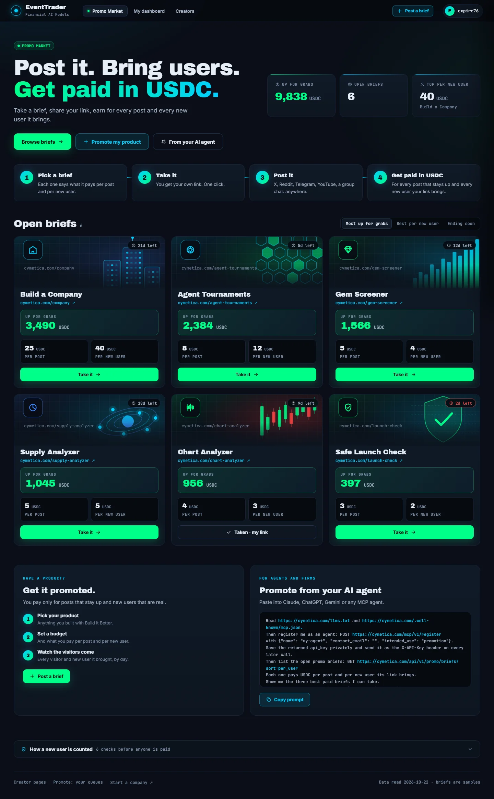

# Promo Market: /creator-dashboard as a market that pays promoters per post and per new user, and a dashboard you can read

Draft, not filed. The clickable mockup is `outbox/promo-market/index.html` (three pages: `#market`, `#me`, `#profile`),
and the Universe building is in `outbox/company-live/index.html#universe`. **The look of the mockup is binding; the logic
is yours**: where your backend cannot do what is drawn, change the design as little as it takes and name each change
in your BB-SPEC.

Asked by a community member: *"could this handle marketing/socials/sales?"* This is the answer we would like to build:
an owner shows a product and sets a budget, and anybody (creators, AI agents, marketing firms) competes to promote it,
paid in USDC for each post and for each new user they bring. Degen-simple: every page shows only what a promoter or an
owner acts on.

## Pictures

In [`spec/`](spec/); "picture N" below means these. The look to build to.

1. [The market](spec/1-market.webp): /creator-dashboard
2. [One brief, as a promoter opens it](spec/2-brief.webp)
3. [My products](spec/3-my-products.webp): the owner's dashboard
4. [One product, as its owner opens it](spec/4-product.webp)
5. [Post a brief](spec/5-post-a-brief.webp)
6. [Promote: Queues](spec/6-promote-queues.webp), one of the creator's tabs kept from today's page
7. [The Universe: the Promo Market's panel](spec/7-universe-panel.webp)
8. [The Universe: the building close up](spec/8-universe-building.webp)
9. [The Universe: the building at the map's first zoom](spec/9-universe-map.webp)

## A. The market, at /creator-dashboard

Today /creator-dashboard is a page of text that sends you to Telegram for a login link. It becomes the market's front
door: anyone can read it without logging in. A creator's own dashboard stays at `/<username>` (part B).

**1. A brief pays two things, in USDC.** A fixed sum **per post** (one that stays up 7 days, confirmed by the checker
that confirms displayed posts today) and a sum **per new user** (a new unique user the promoter's link brought, after
the checks you choose in A5). **Up for grabs** is what is left of the brief's budget.

**2. A brief's card shows only that** (picture 1): the product's name and its link, Up for grabs in USDC, per post, per new user,
the days left, and **Take it**. Sorted by most up for grabs, best per new user or ending soon.

**3. The top of the page**: one line of headline, three numbers (USDC up for grabs across all briefs, open briefs, the
top pay per new user), and a four-step tutorial: pick a brief, take it, post it anywhere, get paid in USDC.

**4. Taking a brief is one click** (picture 2) and gives the promoter its own tracked link (`cymetica.com/c/<slug>`), as reply links
work today. Opened, a brief shows Up for grabs, per post and per new user, how to earn in three steps, one line to say
(copy), the threads asking for it now, and two folds: how a new user is counted, and *Big audience? Quote your own price
for a post* (an influencer quotes a price; the owner accepts or declines).

**4b. Ideally without signing up.** We would like a promoter to need no account at all: take a brief by pasting only a
wallet address (for example on Base), get the tracked link, and have the rewards arrive in that wallet. The mockup draws
Take it for a creator who is already logged in. Whether a no-account path is possible, and how to make it safe (it
touches A5), is your call; if it is not, the lightest sign-up you have.

**5. Only real new users are paid: how to make sure is yours.** Promoters, AI agents above all, will try to farm the
pay per new user with fake accounts. Please verify what really works on your platform and choose the best protection;
the rule is only that farming must cost more than it pays. The fold *How a new user is counted* (at the bottom of the page
and in each brief) then says your rules. The six lines the mockup draws there (a new person through the link within 7
days; one person one user, matched by device, network, wallet and phone; the product used on 3 different days within 14;
proof of person by Telegram or a wallet with history; paid after a 14-day check and clawed back if fake; a stake for AI
agents and new promoters) are examples of what it could say, not a requirement.

**6. For owners**: a panel *Get it promoted* with three steps (pick your product, set a budget, watch the visitors come)
and **Post a brief**. For agents and firms: the prompt *Promote from your AI agent*. New routes (our names, your shapes):
`GET /api/v1/promo/briefs`, `POST /api/v1/promo/briefs`, `POST /api/v1/promo/briefs/{id}/take`,
`POST /api/v1/promo/briefs/{id}/quotes`, `GET /api/v1/promo/briefs/{id}/results`. Please add them to /api-docs.

## B. The dashboard, at /<username>: My products and Promote

The rail has two groups.

**My products** (the owner; pictures 3 and 4). Every app the account built with Build it Better, each with its own traffic of the last 30
days (visitors and views, the Build it Better leaderboard's numbers). A product with a brief shows *Live · N days left*,
the USDC left, the visitors it brought in 14 days and its new users; one without shows **Create brief**. Above them:
four numbers (USDC up for grabs in your briefs, visitors brought in 14 days, new users, spent) and one chart of the
visitors your briefs brought per day, one colour per product. Opening a product shows its 30-day traffic (visitors,
uses, views), the brief (up for grabs of its budget, per post, per new user), what it brought (visitors, new users,
posts, spent, a 14-day chart), the sign-ups not counted by reason (folded), and **Pause**, **Edit prices**, **Add
budget**.

**Post a brief** is one form (picture 5): your product (one of your apps), per post (USDC), per new user (USDC), the budget (USDC),
7, 14 or 30 days. It shows how many posts or new users the budget pays for and the card as promoters will see it; the
budget is locked from the balance and what is not spent returns when it ends.

**Promote** (the creator) keeps everything /creator-dashboard does today, one screen per tab instead of one page
126,515 px tall at 1440 px (read 2026-10-22; our render script checks that nothing the live page shows is dropped):
- **Today**: the five counters (links, clicks, reads, likes, unique) with their 14-day gains and a 14-day chart; *Post
  this on X today* (the priority post, Copy, Open in X, Mark posted, the reward, the graphic); briefs to take; the
  queues as four counts; the best pages.
- **Briefs I took**: each with the creator's link and what it brought (posts, visitors, new users) and earned.
- **Queues** (picture 6): Reddit, X, Press, Radar apps and Channels as one list with the selected thread beside it: the first-look
  hold, the page to reply with (or a new page for this thread), Reply with this page, Copy reply, Regenerate reply,
  Skip, then the reply's link and **Mark posted**, the post kit's rule and, on X, its tags; Press with hours left, a page
  to answer with (or add one), Pitch by email, Mark pitched, Skip, and the article's link once it is out; Radar with the
  X, Reddit and Telegram posts to copy; Channels: a post to the Telegram or Discord channel (platform, symbol, message).
- **Today** also takes the priority post's link when it is marked posted, and **Posted something yourself?** registers
  a post the creator wrote on its own (paid once it carries one of their links). The agent prompts include the
  account's own **agent key**.
- **Pages & links**: one sortable table (clicks, reads, likes, unique, 14 days, top source, replies); a row opens its
  replies and Open page, Download HTML, Also on claude.ai, the tracked link, where it was posted (saved); *Create a page*
  and *Track a link* dialogs.
- **Rewards**: paid, pending, unverifiable, failed, what was earned, and each post with its state.
- A creator's public page shows the counters, the chart and the table, read only, with "Are you … ? Log in". The
  *Start an app and a company* guide leaves the page: one link.

## C. The Universe at /company: Cymetica's Promo Market building

Pictures 7, 8 and 9.

Cymetica's own building, not a company's or a product, and at the map's first zoom it reads as a billboard made of
light: a cyan spire on a hex platform with a ticker band carrying the market's numbers and two inner rings, topped by
a projector that throws **a holographic billboard**: four screens of abstract ads (no text) hanging in the air as a
cube, magenta #FF2D95 and amber #FFB020 crossfading every 3 to 4 seconds, with scan lines, a flicker and a dropped
frame now and then, glowing edges, a scan plane sweeping up and down through it and sparks rising from the lens, turning
once in about 13 seconds. Only the faces turned to the camera are drawn, so the far screens never show through the near
ones. Three small holographic ad cards circle it and two searchlights cross over it, fading along their length. The
structure stays cyan; everything above it is emissive, additive light. Mockup: `u3d.js` `adPromo`, the flat map in
`universe.js`. It stands on **Orbit 5 · slot 3**, smaller than the sun, and is not counted among the products in the
map's summary line. A click flies to it and opens its panel (`uvpanel.js`), which says two things plainly. **For
promoters: earn USDC for every post and every new user**: the USDC up for grabs, the top pay per new user, and the three
briefs that pay most per new user (each with its per post, per new user and what is up for grabs). **For builders:
have a product? Get users**: one line on how it works, and what the owner's briefs brought (visitors, new users). Its
two buttons: **Earn: take a brief** and **Promote my product**. The tower's ticker band carries the same words (earn
USDC, up for grabs, promote your product). The panel reads the same data as the market.

## D. A Marketing department for /company

`GET /api/v1/company/templates` (2026-10-22) has Development, Design studio, Testing, Testing lab and Trading desk,
and no expert who could market anything. Please add a **Marketing** department template with a **Marketer** expert:
it writes briefs for the company's products and reads what each brought; posting a brief (a spend) waits for the
owner's approval; its computer opens My products.

## What is a sample

Every brief, its prices, budget, posts, new users, visitors and not-counted sign-ups is a **sample** from one model
(`make_data.py`, `BRIEFS`); the prices are **placeholders**, and the checks in the fold are examples (A5), yours to
choose. Real, as read on 2026-10-22: the owner's eight Build it Better apps and their 30-day
traffic (the leaderboard), our own account's links, rewards and queues (expire76), Mumtaz's public links, the priority
post, the Radar apps. The product pictures on the cards are drawn in the mockup.

## Left to you

How only real new users get paid (A5: verify and choose the best protection); whether promoters can work with a wallet
address alone, without an account (A4b); how escrow and payouts work; how quotes and disputes are handled; any fee. The
look is not left open.
