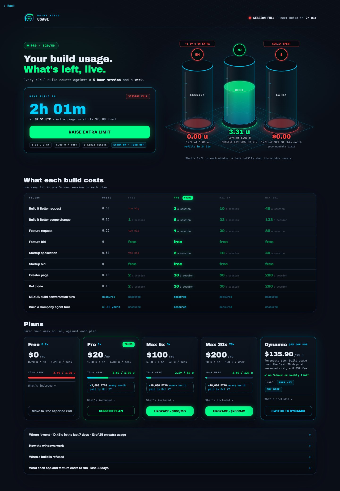

# Build Usage

Design of Build Usage (`cymetica.com/usage`). **Read [1-build-it-better/spec.txt](1-build-it-better/spec.txt)**: what to build, why, every part.

## Run it

Download this folder and open `mock.html` in a browser. Every figure is computed in the page from `data.js`: one reading of our own account's `GET /api/v1/nexus/usage`, `/dynamic`, `/plans` and `/plans/costs` (2026-10-22 05:50 UTC). Nothing is sent anywhere.

The bar at the top right switches the three states: signed in (session full, the countdown ticks), after 07:51 (the same account one minute after its session resets), signed out. All three share one build, picture 3's. Try What's included on the plans and the folds at the bottom (Where it went, then Show all).

`mock.html?shot=1&state=live`, `&state=ready`, `&state=out`: the frozen states in `pictures/`.

## Files

- `mock.html` the page, its styles and its logic
- `data.js` the reading the page draws
- `pictures/` the target, 1440 px
- `1-build-it-better/spec.txt` the Build it Better text
